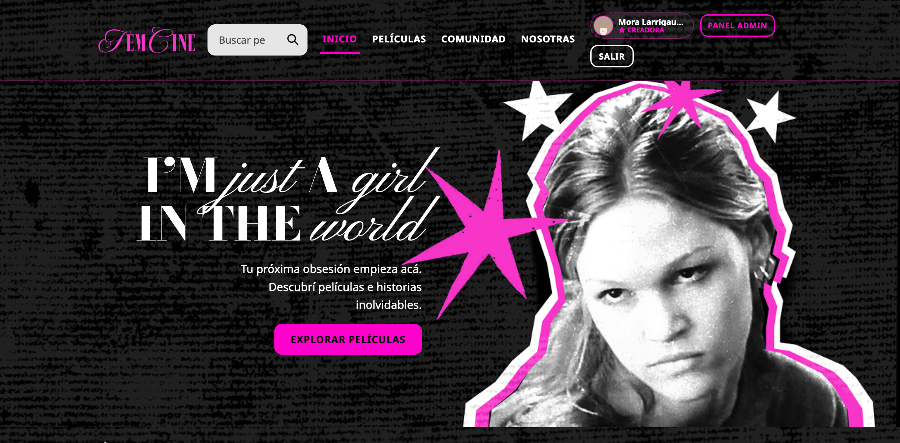
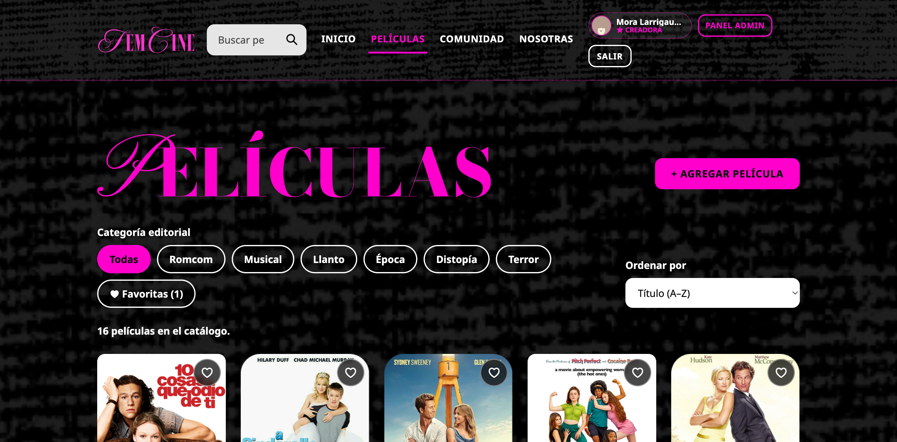
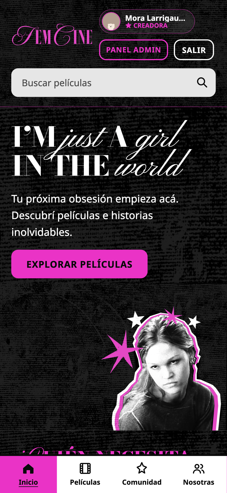

# FemCine

Catálogo de películas y comunidad cinéfila con colecciones editoriales, reseñas, publicaciones y un oráculo interactivo en español.

## Enlaces del proyecto

| Recurso | Enlace |
| --- | --- |
| Aplicación publicada | [femcine.vercel.app](https://femcine.vercel.app/) |
| Repositorio | [mora-larrigaudiere-c/WEB-ROMCOM](https://github.com/mora-larrigaudiere-c/WEB-ROMCOM) |
| Código de la aplicación | [Carpeta de FemCine](femcine/) |
| Supabase · Project URL | https://umlryyxwjswdcwykughr.supabase.co |

La Project URL de Supabase es la dirección base de la API; no es una página de presentación. El catálogo, Google y la base de datos ya están conectados en la aplicación publicada.

## Integrantes

- **Mora Larrigaudiere Curutchet** — Diseñadora Multimedial.
- **Oriana Fuentes Castro** — Diseñadora Multimedial. En la interfaz figura como Oriana Fuentes.

Ambas comparten curaduría editorial, diseño visual, experiencia de usuario y desarrollo web. Las dos cuentas de las creadoras tienen el mismo rol de administración.

## Funcionalidades implementadas

- Catálogo público compartido con **16 películas**, buscador, filtros por categoría y ordenamiento por título o año.
- Fichas con póster, sinopsis, dirección, duración y reseñas de la comunidad.
- Inicio y cierre de sesión con **Google**, perfil y actividad de cada usuaria.
- Favoritos y calificaciones personales, separados por cuenta.
- Reseñas de películas y publicaciones propias en el **Club del Drama**.
- Moderación: los aportes nuevos o editados quedan pendientes hasta que una administradora los aprueba.
- Panel de creadoras para agregar, editar y eliminar películas y moderar aportes.
- Formularios con `v-model`, validaciones personalizadas y mensajes de error visibles.
- Oráculo con bola animada, sonido y respuestas en español obtenidas mediante **Fetch a YesNoOracle**.
- Diseño para móvil, tablet y escritorio, navegación móvil, transiciones Vue y `transition-group`.
- Formulario de suscripción de demostración: valida y registra el correo en LocalStorage; no realiza envíos de email.

## Capturas de la aplicación publicada

Capturas reales tomadas el **11 de noviembre de 2026**. La sesión visible corresponde a una creadora; los controles administrativos se muestran según el rol.

### Inicio · escritorio



### Catálogo · escritorio



### Club del Drama · escritorio


### Inicio · móvil



## Tecnologías

**Vue 3 (Options API), Vue CLI 5, Vue Router 4, JavaScript, CSS, LocalStorage, Fetch, Supabase Auth/PostgreSQL y Web Audio API.**

La aplicación incluye componentes reutilizables, comunicación mediante `props` y `emits`, propiedades `computed` y hooks `created()` y `mounted()`.

## Instalación y ejecución local

Requisitos: **Node.js 22 o superior**, npm y Git.

```sh
git clone https://github.com/mora-larrigaudiere-c/WEB-ROMCOM.git
cd WEB-ROMCOM/femcine
npm ci
npm run dev
```

Abrir http://localhost:3000/. Sin variables de Supabase se puede explorar el modo local; Google y la persistencia compartida requieren la configuración de la sección siguiente.

```sh
npm test        # Pruebas automáticas del proyecto
npm run build  # Compilación de producción en dist/
```

## Datos y permisos

| Cuenta | Permisos |
| --- | --- |
| Visitante | Consultar catálogo, fichas y aportes aprobados; usar el oráculo. |
| Usuaria con Google | Administrar su perfil, favoritos y calificaciones; enviar y editar sus propios aportes. |
| Administradora | Gestionar el catálogo y aprobar o rechazar contenido comunitario. |

Supabase utiliza las tablas `movies`, `profiles`, `admin_roles`, `movie_preferences`, `reviews` y `posts`. Las políticas **RLS** controlan los permisos en la base de datos. La API pública de perfiles no expone correos y cada usuaria accede a sus propias preferencias.

**LocalStorage** conserva la caché pública y datos del dispositivo. **Supabase** mantiene el catálogo compartido, los perfiles, los aportes y las preferencias de las cuentas. Al restaurar la sesión de Google, la consulta pública del catálogo se completa sin descartar sus resultados.

## Configuración de otro proyecto Supabase

El proyecto publicado ya está configurado. Para conectar una copia a otro proyecto:

1. Ejecutar [supabase/schema.sql](femcine/supabase/schema.sql) en el SQL Editor del nuevo proyecto. Crea las seis tablas, permisos, políticas y 16 películas iniciales. El seed puede repetirse sin reemplazar las ediciones existentes.
2. Crear `femcine/.env.local` con los valores públicos de ese proyecto:

```dotenv
VUE_APP_SUPABASE_URL=https://TU_PROYECTO.supabase.co
VUE_APP_SUPABASE_ANON_KEY=TU_CLAVE_PUBLICABLE
```

3. Habilitar Google en **Authentication → Sign In / Providers**. El Client ID y el Client Secret se guardan únicamente allí. Nunca incluir el secret de Google ni una clave `service_role` en el código o en variables `VUE_APP_*`.
4. Registrar en Google el callback `https://TU_PROYECTO.supabase.co/auth/v1/callback`. Configurar en Supabase el Site URL de producción y las Redirect URLs de los entornos que se utilicen.
5. Cada creadora inicia sesión una vez. Luego asignar su rol por el UUID real con [supabase/bootstrap_admin.sql](femcine/supabase/bootstrap_admin.sql).
6. Reiniciar el servidor local o volver a compilar después de cambiar las variables.

## Despliegue y rutas

En Vercel se utiliza la carpeta raíz **`femcine`**, preset **Vue.js**, build **`npm run build`** y salida **`dist`**. Las dos variables públicas de Supabase se configuran en Vercel. [vercel.json](femcine/vercel.json) permite recargar las rutas de Vue Router directamente.

Rutas principales: `/`, `/peliculas`, `/peliculas/:id`, `/peliculas/nueva`, `/peliculas/:id/editar`, `/comunidad`, `/perfil`, `/nosotras` y `/admin`. Las pantallas de gestión requieren una cuenta administradora.

## Comprobaciones realizadas

- **29/29 pruebas automáticas** del proyecto y compilación de producción correctas.
- **9/9 comprobaciones independientes** del frontend: aislamiento entre cuentas, respuestas tardías, guardado antes de navegar y sincronización del catálogo al restaurar Google.
- Inicio con Google, creación del perfil y roles de las dos creadoras verificados en producción.
- Alta, edición, recarga y eliminación de una película temporal; el catálogo quedó nuevamente con 16 películas.
- Validaciones de obligatorios, longitudes, números y URL de póster comprobadas en pantalla.
- Favoritos y calificaciones recuperados al recargar y reabrir una pestaña.
- Una reseña y una publicación creadas desde una cuenta sin administración, conservadas y visibles después de aprobarse.
- Vistas de móvil de 393 px, tablet de 768 px y escritorio revisadas.

Para ejecutar las comprobaciones independientes desde la carpeta `femcine`:

```sh
node --experimental-vm-modules verification/frontend-regressions.mjs .
```

## Documentación complementaria

- [Estado de entrega](femcine/docs/ENTREGA.md).
- [Guía de defensa oral](femcine/docs/DEFENSA.md).
- [Guion de video](femcine/docs/GUION-VIDEO.md).

El video final y el ZIP definitivo se preparan por separado; estas capturas no los sustituyen.
